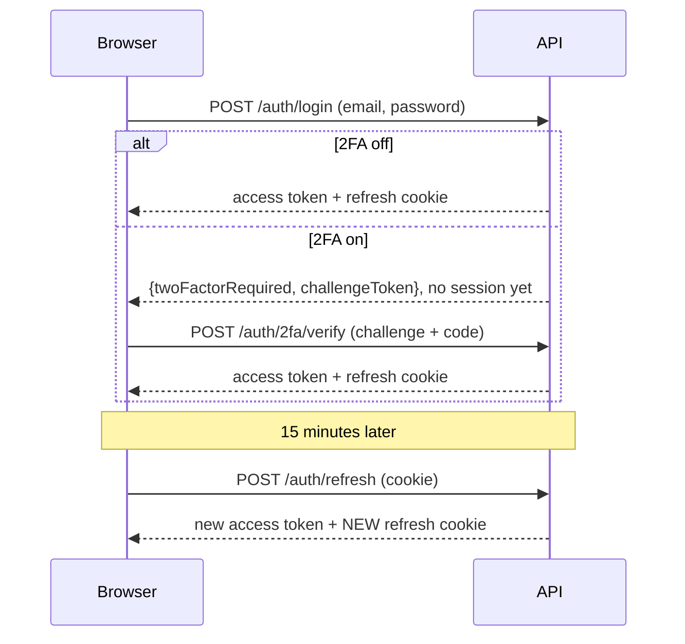

# TimSol Login Page

[](https://github.com/Timothy-dev-tech/LOGIN-PAGE-PROJECT/actions/workflows/ci.yml)

A full-stack authentication project by Timothy, [TimSol Technologies](https://timsol.dev): sign-up and sign-in with short-lived access tokens and rotating refresh cookies, optional two-factor authentication, device and activity pages, role-based access, and a small study-log dashboard for the login to protect. The point is the **security decisions**, written down below so each can be checked against the code.

## Features

- **Accounts and sessions:** register, sign in ("remember me" = 30 days, otherwise 1 day), sign out. A Devices page lists where you are signed in and can end any session.
- **Two-factor authentication (optional):** TOTP codes from any authenticator app, plus one-time recovery codes.
- **Activity log** (90 days), **roles** (`user`, `admin`; the first admin is made from the command line), and a paginated **study log** owned per user.
- Light and dark themes, axe-checked accessibility, works down to a 360 px phone.

**Stack:** Vite + TypeScript (no framework) on the frontend; Node, Express 5, Mongoose 9 and MongoDB on the backend; bcryptjs, JWT and Node `crypto` for auth. Tested with Vitest, Supertest and Postman.

## How sign-in works



## Run it locally

You need Node 20.19+ and a MongoDB database (a free [Atlas](https://www.mongodb.com/atlas) cluster works).

```bash
cd server && npm install && cp .env.example .env   # fill in .env, then:
npm run dev                                        # API on :4000
cd .. && npm install && npm run dev                # frontend on :5173, proxies /api
```

| `server/.env` | Required | Meaning |
|---|---|---|
| `MONGODB_URI` | yes | MongoDB connection string |
| `CLIENT_ORIGIN` | yes | Exact frontend origin, e.g. `http://localhost:5173` |
| `JWT_ACCESS_SECRET` | yes | 32+ characters, signs access tokens |
| `TWO_FACTOR_KEY` | yes | Base64 of 32 random bytes, encrypts 2FA secrets |

Generate secrets with `node -e "console.log(require('crypto').randomBytes(32).toString('base64'))"`. The server refuses to start if a required value is missing, and says which. Never commit `.env`. Create the first admin with `ADMIN_EMAIL=… ADMIN_PASSWORD=… npm run seed:admin` (from `server/`).

## Tests

`cd server && npm test` (API, in-memory MongoDB) and `npm test` at the root (frontend). `docs/postman/` has a collection and guide that exercise the running server (105 requests, about 210 checks). Some tests fire simultaneous requests to prove a token can only be used once; they need a real MongoDB (set `SKIP_ATOMICITY_TESTS=1` on non-atomic stand-ins).

## Security decisions

- **Passwords:** bcrypt hashes only. Login gives the same error and similar timing for "no such email" and "wrong password".
- **Tokens:** a 15-minute access token held **only in memory**; a refresh token in an `httpOnly`, `SameSite=Strict` cookie scoped to `/api/auth`, stored as a SHA-256 hash. Every refresh is **rotated** with one atomic update, and reuse of a spent token revokes the whole session. Refresh and logout also check `Origin`.
- **2FA:** TOTP on Node `crypto`, verified against the RFC 6238 test vectors. Secrets are encrypted with AES-256-GCM (bound to the user id). A correct password on a 2FA account yields only a 5-minute challenge token, never a session. Codes work once, five misses lock 2FA for 15 minutes, recovery codes are stored hashed and claimed atomically, and turning 2FA off needs the password and a code.
- **Input and access:** validators reject wrong types (blocks NoSQL injection) and ignore unknown fields (blocks mass assignment, e.g. `"role":"admin"`). Roles are checked against the database on each admin request. Other users' data returns 404. Failed logins and 2FA attempts are rate limited. `helmet`, single-origin CORS, a body-size limit, and an error handler that never leaks stack traces. The UI sets all dynamic content as text, never HTML.

## Known limitations

- An access token stays valid up to 15 minutes after sign-out (tokens are stateless).
- If a refresh reply is lost in transit, a later retry looks like token reuse and ends the session (the cost of strict rotation).
- Rate-limit counters live in server memory: fine for one instance, a shared store (Redis) would be needed for several.
- 2FA can be locked for 15 minutes by someone who already knows your password; the alternative, unlimited guessing, is worse.
- No email verification or password reset, and no profile page or account deletion yet.

## Layout

`index.html`, `register.html`, `dashboard.html` … and `src/` (frontend: `css/`, `ts/`, `ts/views/`); `server/src/` (`config`, `routes`, `controllers`, `services`, `models`, `middleware`, `validation`, `utils`); `docs/postman/`.

## Licence

Add a licence of your choice (MIT is a common default).
